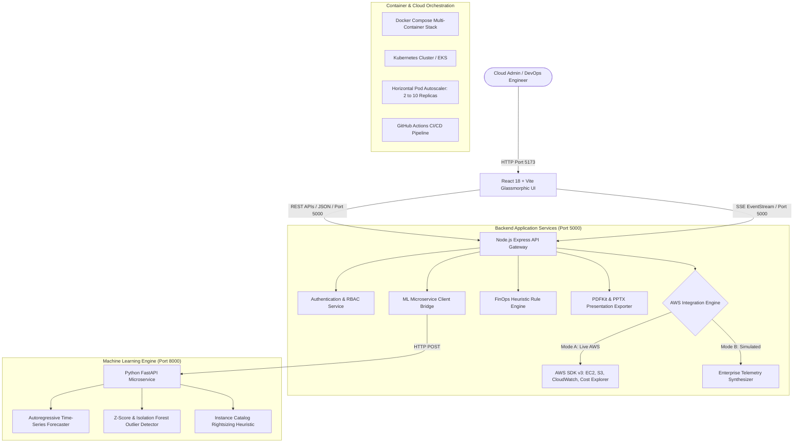

# 🌐 CloudOptix AI — Comprehensive Project Specification & Architectural Documentation

> **AI-Powered Cloud Cost Optimization, FinOps Resource Management & Autonomous Remediation Platform**  
> *Author: Aryan Sharma & CloudOptix Team*  
> *Target Domain: Cloud Computing, DevOps & FinOps Engineering*  
> *Version: 1.0.0 | Production Ready*

---

## 📑 Table of Contents
1. [Executive Summary & Problem Statement](#1-executive-summary--problem-statement)
2. [High-Level Architecture & Data Flow](#2-high-level-architecture--data-flow)
3. [Technology Stack](#3-technology-stack)
4. [Directory & File Breakdown](#4-directory--file-breakdown)
5. [Core Features & Technical Implementation](#5-core-features--technical-implementation)
6. [FinOps Heuristics & Mathematical Models](#6-finops-heuristics--mathematical-models)
7. [REST API Gateway Specification](#7-rest-api-gateway-specification)
8. [DevOps, Containerization & Kubernetes](#8-devops-containerization--kubernetes)
9. [Step-by-Step Setup & Running Guide](#9-step-by-step-setup--running-guide)
10. [Current Status & Future Roadmap](#10-current-status--future-roadmap)
11. [Viva & Examiner Q&A Cheat Sheet](#11-viva--examiner-qa-cheat-sheet)

---

## 1. Executive Summary & Problem Statement

### The Cloud Waste Crisis
Public cloud infrastructure (such as Amazon Web Services) allows organizations to provision computing resources instantaneously. However, without automated financial governance (FinOps), enterprises routinely suffer from **30% to 45% unoptimized cloud expenditure**.

Key causes of cloud waste identified in enterprise workloads:
1. **Over-Provisioned Compute**: Virtual machines (EC2 instances) configured as large instance types (`m5.xlarge`, `t3.large`) that sustain under 5% average CPU utilization.
2. **Orphaned Storage Disks**: Unattached Elastic Block Store (EBS) volumes with provisioned IOPS left running after compute instances are terminated.
3. **Stagnant Object Storage**: Multi-terabyte Amazon S3 buckets accumulating cold, rarely accessed objects retained in standard, expensive storage classes rather than lifecycle-transitioned to Amazon S3 Glacier.
4. **Unregulated 24/7 Staging Environments**: Development and testing environments left running over nights and weekends (168 hours/week instead of 55 active business hours).
5. **Lack of Predictive Visibility**: Engineering teams lack forward-looking time-series forecasts to anticipate billing anomalies before the invoice arrives.

### The CloudOptix AI Solution
**CloudOptix AI** bridges the gap between DevOps operations and cloud financial management. It collects live CloudWatch telemetry, runs automated FinOps heuristic rules, models predictive time-series spend projections using machine learning, and enables 1-click autonomous rightsizing and remediation.

---

## 2. High-Level Architecture & Data Flow



### The Dual-Mode Architecture
CloudOptix AI is designed with an intelligent **Dual-Mode Engine**:
1. **Live AWS Mode**: When valid AWS IAM credentials (`AWS_ACCESS_KEY_ID`, `AWS_SECRET_ACCESS_KEY`) are provided in `.env` or via the web modal, the system calls real AWS SDK v3 endpoints to inspect live EC2 instances, S3 buckets, and CloudWatch metrics.
2. **Telemetry Simulator Mode**: When working offline or in demonstration environments, the system generates 24 realistic enterprise cloud resources across EC2, RDS, S3, EBS, and Lambda with dynamic utilization spikes and waste signatures. All actions (starting/stopping instances, rightsizing tiers) update in memory and recalculate financial metrics instantaneously.

---

## 3. Technology Stack

### Frontend Tier
- **Framework**: React 18.3.1 with Vite (ultra-fast Hot Module Replacement)
- **Styling Architecture**: Custom Glassmorphic Vanilla CSS with CSS custom property tokens (zero layout shifts, ultra-responsive dark/light themes)
- **Icons**: Lucide React (`lucide-react`)
- **Data Visualization**: Recharts (smooth SVG/Canvas rendering for spend trajectories and forecast bands)
- **State Management**: React Context API (`AuthContext.jsx`, `CloudContext.jsx`)
- **Real-Time Data**: Server-Sent Events (SSE) native `EventSource` connection

### Backend Gateway Tier
- **Runtime**: Node.js v20+ with Express v4.21.2
- **Cloud Integration**: AWS SDK v3 (`@aws-sdk/client-ec2`, `@aws-sdk/client-s3`, `@aws-sdk/client-cloudwatch`, `@aws-sdk/client-cost-explorer`)
- **Security & Middleware**: CORS (`cors`), environment variable injection (`dotenv`)
- **Executive Exporting**:
  - `pdfkit`: Dynamic vector-rendered FinOps executive audit reports
  - `pptxgenjs`: Dynamic multi-slide executive presentation decks

### Python AI/ML Engine
- **Framework**: Python 3.11 with FastAPI & Uvicorn
- **Algorithms**: Scikit-Learn, NumPy, mathematical linear and polynomial autoregression
- **Resilience**: Embedded mathematical regression fallback inside Node.js so that the platform functions even if Python is offline.

### DevOps & Cloud Infrastructure
- **Containerization**: Multi-stage production `Dockerfile` for frontend (Nginx Alpine) and backend (Node Alpine)
- **Orchestration**: Kubernetes manifests (`/k8s`) with Pod Autoscaling (HPA), Ingress, and StatefulSets
- **CI/CD**: GitHub Actions workflow (`.github/workflows/ci-cd.yml`)

---

## 4. Directory & File Breakdown

```
c2 aws ai/
├── .github/
│   └── workflows/
│       └── ci-cd.yml              # Automated build, lint, and test pipeline
├── backend/
│   ├── src/
│   │   ├── controllers/
│   │   │   ├── adminController.js     # User management & audit logs
│   │   │   ├── authController.js      # Email OTP, Phone OTP & SSO handlers
│   │   │   └── dashboardController.js # FinOps telemetry, recommendations & exports
│   │   ├── data/
│   │   │   ├── tracked_services.json  # In-memory simulated cloud resource state
│   │   │   └── users.json             # Registered users, roles & password hashes
│   │   ├── routes/
│   │   │   ├── admin.js               # Admin protected endpoints
│   │   │   └── api.js                 # Public & FinOps REST API endpoints
│   │   ├── services/
│   │   │   ├── authService.js         # OTP generator, JWT verification & RBAC logic
│   │   │   ├── awsCollectorService.js # AWS SDK v3 client + Telemetry simulator
│   │   │   ├── liveTrackingEngine.js  # Live resource state tracker
│   │   │   └── mlClientService.js     # Bridge to Python ML + JS analytical fallback
│   │   └── server.js                  # Express bootstrap, CORS & route registry
│   ├── .env.example                   # Template environment variables
│   ├── Dockerfile                     # Production Node container specification
│   └── package.json                   # Backend dependencies
├── frontend/
│   ├── src/
│   │   ├── components/
│   │   │   ├── AuthModal.jsx              # Slide-in login modal with OTP inputs
│   │   │   ├── ConnectAwsModal.jsx        # AWS IAM live credential configuration
│   │   │   ├── CostBreakdown.jsx          # Interactive spend per AWS service charts
│   │   │   ├── Ec2ControlCenter.jsx       # Compute fleet management & instance actions
│   │   │   ├── Ec2LiveTelemetryBanner.jsx # Live CPU/RAM gauge visualizations
│   │   │   ├── EnableServiceModal.jsx     # On-the-fly AWS service provisioning
│   │   │   ├── FinOpsMaturityAndCarbon.jsx# GreenOps carbon footprint & maturity index
│   │   │   ├── ForecastSection.jsx        # 30/60/90-day ML predictive cost graph
│   │   │   ├── K8sAutoscaling.jsx         # Live Kubernetes HPA interactive simulator
│   │   │   ├── LiveActivityFeed.jsx       # Real-time event log of infrastructure events
│   │   │   ├── LoginPage.jsx              # Dedicated standalone authentication page
│   │   │   ├── MetricCards.jsx            # Monthly spend, potential savings, waste cards
│   │   │   ├── Navbar.jsx                 # Global header, currency toggle, report downloads
│   │   │   ├── RecommendationsList.jsx    # FinOps recommendation cards with 1-click apply
│   │   │   ├── ResourceTable.jsx          # Filterable multi-cloud resource inventory
│   │   │   ├── S3ControlCenter.jsx        # Storage bucket fleet & lifecycle tiering
│   │   │   ├── S3LiveTelemetryBanner.jsx  # Live storage metric monitor
│   │   │   ├── SecurityScanner.jsx        # Security vulnerabilities & compliance check
│   │   │   └── UserAuthView.jsx           # User profile & account switch view
│   │   ├── context/
│   │   │   ├── AuthContext.jsx            # Authentication state, token & login methods
│   │   │   └── CloudContext.jsx           # Global FinOps telemetry, currency & simulation state
│   │   ├── App.jsx                        # Primary dashboard layout & view switcher
│   │   ├── index.css                      # Global design system & theme variables
│   │   └── main.jsx                       # React DOM entrypoint
│   ├── Dockerfile                         # Multi-stage Nginx container specification
│   ├── nginx.conf                         # High-performance static web server config
│   ├── package.json                       # Frontend dependencies
│   └── vite.config.js                     # Vite build & proxy settings
├── k8s/
│   ├── backend-deployment.yaml    # Replicated backend pods with readiness probes
│   ├── frontend-deployment.yaml   # Nginx frontend pods
│   ├── hpa.yaml                   # Horizontal Pod Autoscaler configuration (2-10 pods)
│   ├── ingress.yaml               # Routing ingress rules
│   └── postgres-statefulset.yaml  # Stateful database persistence with PVC
├── ml-service/
│   ├── app.py                     # FastAPI microservice for ML forecasting
│   ├── Dockerfile                 # Python slim container specification
│   └── requirements.txt           # Scikit-learn, FastAPI, Uvicorn dependencies
├── ARCHITECTURE.md                # System architectural blueprint
├── docker-compose.yml             # Full-stack local multi-container composition
├── start.bat                      # 1-Click Windows launcher script
└── README.md                      # Project repository documentation
```

---

## 5. Core Features & Technical Implementation

### 5.1 Multi-Method Authentication & RBAC
- **Email OTP**: Dispatches a 6-digit numeric verification code with a 5-minute expiry. Supports automatic 6-box keyboard focus and paste handling.
- **Phone OTP**: Dispatches mobile verification tokens for quick field technician access.
- **1-Click Google SSO**: Fast-track corporate Google Workspace connection.
- **Role-Based Access Control**:
  - `SysAdmin` (`admin@cloudoptix.ai`): Full fleet management, terminating instances, applying cost policies.
  - `Admin` (`aryan.cloud@gmail.com`): Modifying resources and configuring AWS credentials.
  - `Viewer`: Read-only access to metrics and reports.

### 5.2 Real-Time FinOps Dashboard
- **Live Spending Metrics**:
  - **Monthly Spend**: Active accrued cost across all services.
  - **Projected Run-rate**: Forward calculation of month-end expenditure.
  - **Savings Potential**: Cumulative dollar savings achievable via automated remediation.
  - **Waste Index**: Percentage metric representing unused allocated capacity ($0\% - 100\%$).
- **Currency Localization**: Seamless instant conversion between **USD ($)** and **INR (₹)** across all cards, tables, and reports.

### 5.3 EC2 Compute Fleet Control Center
- Discovers instances across regions (`us-east-1`, `ap-south-1`, `eu-west-1`).
- Real-time CPU, memory, and hourly cost telemetry.
- **Direct Lifecycle Operations**:
  - `Start`: Launches stopped compute instances.
  - `Stop`: Shuts down idle machines to eliminate compute hourly charges.
  - `Reboot`: Safely recycles instances experiencing memory leaks.
  - `Terminate`: Completely de-provisions decommissioned servers.

### 5.4 S3 Storage Management & Tiering
- Inspects storage buckets, total object counts, and storage volumes in GB.
- **Security Check**: Immediately flags buckets with public read/write permissions.
- **Lifecycle Migration**: 1-click execution of automated transition rules from `S3 Standard` ($\approx \$0.023/\text{GB}$) to `S3 Glacier Flexible Retrieval` ($\approx \$0.0036/\text{GB}$), generating an immediate **$84\%$ storage cost savings**.

### 5.5 AI Recommendations & "What-If" FinOps Simulator
- Automatically evaluates infrastructure against FinOps heuristics:
  - Downsizing underutilized instances (`t3.large` $\to$ `t3.micro`).
  - Purging unattached EBS volumes.
  - Implementing weekend off-hours scheduling on staging instances.
- **Interactive "What-If" Simulation**:
  - Clicking **Apply** immediately reduces the projected spend in real time.
  - Logs the exact dollar and rupee savings realized.
  - Features a **Reset Simulation** button to roll back changes for testing.

### 5.6 Predictive Machine Learning Engine
- **Time-Series Regression**: Models future expenditure curves across 30, 60, and 90 days.
- **Confidence Intervals**: Calculates $\pm 2\sigma$ upper and lower probabilistic prediction bounds.
- **Anomaly Detection**: Evaluates resource consumption variance against baseline metrics; flags anomalous spend spikes.

### 5.7 Cloud Security & Compliance Scanner
- Audits cloud assets against CIS AWS Foundations Benchmarks:
  - Security Groups with unrestricted SSH access (`0.0.0.0/0` on port 22).
  - Unencrypted EBS storage volumes at rest.
  - Missing Multi-Factor Authentication (MFA) on root accounts.
  - Publicly accessible S3 buckets.

### 5.8 Executive Export Engine
- **PDF Report**: Generates a high-resolution, vector-rendered executive audit summarizing monthly spend, waste index, savings breakdown, and remediation actions using `pdfkit`.
- **PowerPoint (.pptx)**: Compiles an executive deck complete with title slides, KPI scorecards, and optimization recommendations using `pptxgenjs`.

---

## 6. FinOps Heuristics & Mathematical Models

### 6.1 EC2 Rightsizing Formula
When average CPU utilization over a 30-day evaluation window is below $5\%$:
$$\text{Average CPU}_{30\text{d}} < 5\% \implies \text{Trigger Downsize Action}$$

$$\text{Monthly Savings} = (\text{Cost}_{\text{current}} - \text{Cost}_{\text{recommended}}) \times 730 \text{ hours/month}$$

*Example: Downsizing `t3.large` (\$0.0832/hr) to `t3.micro` (\$0.0104/hr):*
$$\text{Savings} = (0.0832 - 0.0104) \times 730 = \mathbf{\$53.14/\text{month per instance}}$$

### 6.2 Staging Off-Hours Schedule Optimization
Non-production staging servers only need to run during working business hours:
$$\text{Active Business Hours} = 11 \text{ hrs/day} \times 5 \text{ days/week} = 55 \text{ hrs/week}$$
$$\text{Total Calendar Hours} = 24 \text{ hrs/day} \times 7 \text{ days/week} = 168 \text{ hrs/week}$$
$$\text{Cost Reduction Percentage} = \left( 1 - \frac{55}{168} \right) \times 100\% = \mathbf{67.26\% \text{ Compute Savings}}$$

### 6.3 Kubernetes Horizontal Pod Autoscaler (HPA) Formula
The desired number of running application pods is dynamically governed by metric utilization:
$$\text{Desired Replicas} = \left\lceil \text{Current Replicas} \times \left( \frac{\text{Current Metric Value}}{\text{Target Metric Value}} \right) \right\rceil$$

### 6.4 Statistical Spend Anomaly Detection (Z-Score)
To identify abnormal spending spikes without false positives:
$$z = \frac{x - \mu}{\sigma}$$
- $x$ = Current hourly spend / metric value
- $\mu$ = Rolling 30-day moving average
- $\sigma$ = Standard deviation of the rolling window
- Condition: If $|z| > 2.58$ (corresponding to a 99% confidence interval), the event is flagged as a **Critical Cost Anomaly**.

---

## 7. REST API Gateway Specification

| Method | Endpoint | Description | Payload / Query Parameters |
| :--- | :--- | :--- | :--- |
| `GET` | `/api/health` | Gateway health check & version info | None |
| `GET` | `/api/summary` | Executive FinOps KPIs & spend breakdown | None |
| `GET` | `/api/resources` | Full multi-cloud resource inventory | `?service=ec2&region=ap-south-1` |
| `GET` | `/api/stream` | Server-Sent Events (SSE) telemetry stream | None |
| `POST` | `/api/auth/email/send-otp` | Generate and dispatch 6-digit email OTP | `{"email": "user@org.ai"}` |
| `POST` | `/api/auth/email/verify-otp` | Verify 6-digit email OTP and authenticate | `{"email": "...", "otp": "123456"}` |
| `POST` | `/api/auth/google` | Fast-track Google SSO authentication | `{"email": "...", "name": "..."}` |
| `GET` | `/api/recommendations` | Active FinOps optimization recommendations | None |
| `POST` | `/api/recommendations/apply` | Execute 1-click remediation action | `{"recommendationId": "REC-01"}` |
| `POST` | `/api/simulation/reset` | Rollback simulation state to baseline | None |
| `GET` | `/api/forecast` | ML time-series spend projections | None |
| `GET` | `/api/anomalies` | Statistical cost anomaly detection list | None |
| `GET` | `/api/security` | Cloud security & compliance audit results | None |
| `POST` | `/api/ec2/action` | Perform lifecycle action (start/stop/reboot) | `{"instanceId": "...", "action": "stop"}` |
| `GET` | `/api/s3/fleet` | S3 bucket inventory & storage metrics | None |
| `POST` | `/api/admin/export/pdf` | Generate downloadable FinOps Executive PDF | None |
| `POST` | `/api/admin/export/pptx` | Generate downloadable Executive PPTX Deck | None |

---

## 8. DevOps, Containerization & Kubernetes

### 8.1 Multi-Stage Containerization
- **Frontend Dockerfile**:
  - Stage 1: Compiles React application into optimized static assets using Node 20.
  - Stage 2: Packages output into an ultra-lightweight Nginx Alpine image (< 25 MB).
- **Backend Dockerfile**: Production-hardened Node.js image running under non-privileged service user.

### 8.2 Kubernetes Orchestration (`/k8s`)
- `backend-deployment.yaml`: Configures rolling updates, resource limits (`cpu: 500m`, `memory: 512Mi`), and liveness/readiness HTTP probes targeting `/api/health`.
- `hpa.yaml`: Automatically scales backend pods between **2 and 10 replicas** based on a $70\%$ target CPU threshold.
- `ingress.yaml`: Routes traffic between public domain endpoints and internal cluster services.

---

## 9. Step-by-Step Setup & Running Guide

### Prerequisites
- **Node.js** v18+ (v20+ recommended)
- **Git**
- *(Optional)* Python 3.10+ for the standalone ML microservice

### 1-Click Launch (Windows)
Double-click or run:
```cmd
.\start.bat
```
This automatically starts both the backend API (port 5000) and frontend interface (port 5173) in separate windows.

### Manual Terminal Launch
1. **Backend Setup:**
   ```bash
   cd backend
   npm install
   # Create .env from template
   Copy-Item .env.example .env    # On Windows
   cp .env.example .env           # On Linux/macOS
   npm start
   ```
2. **Frontend Setup:**
   ```bash
   cd frontend
   npm install
   npm run dev
   ```
3. **Access Application:**
   Open browser at: **`http://localhost:5173`**  
   Log in using preset: **`admin@cloudoptix.ai`** (SysAdmin) or **`aryan.cloud@gmail.com`** (Admin).

---

## 10. Current Status & Future Roadmap

### ✅ Completed & Production-Ready
- [x] Full FinOps Executive KPI Dashboard with multi-currency (USD/INR)
- [x] Multi-method authentication (Email OTP, Phone OTP, Google SSO, RBAC)
- [x] Dual-mode engine (Live AWS SDK v3 integration + Enterprise Telemetry Simulator)
- [x] EC2 Fleet Control Center (Start, Stop, Reboot, Terminate)
- [x] S3 Storage Center (Bucket discovery, storage tiering, public risk detection)
- [x] 1-Click FinOps Recommendation Engine & "What-If" Simulation with instant recalculation
- [x] 30/60/90-Day ML Cost Forecasting with Confidence Bands
- [x] Statistical Anomaly Detection (Z-score algorithm)
- [x] Security & Compliance Scanner (CIS Benchmark checks)
- [x] Kubernetes Horizontal Pod Autoscaler interactive simulation
- [x] Vector PDF and PPTX executive presentation exporter
- [x] Git security: `.env` and sensitive AWS credentials strictly ignored

### 🚀 Recommended Next Milestones (For You & Teammates)
1. **Database Persistence**: Replace the local JSON data store (`users.json`, `tracked_services.json`) with PostgreSQL or AWS DynamoDB.
2. **Third-Party Messaging APIs**: Integrate real email delivery (SendGrid / AWS SES) and SMS dispatch (Twilio) for production OTP delivery.
3. **Multi-Cloud Expansion**: Add Microsoft Azure Resource Manager (ARM) and Google Cloud Platform (GCP) collector modules.
4. **Autonomous Slack / Discord Webhooks**: Send instant alerts to DevOps Slack channels whenever a cost anomaly exceeds a defined threshold.
5. **Live Cloud Deployment**: Host frontend on Vercel/Netlify and containerized backend on AWS ECS or EKS.

---

## 11. Viva & Examiner Q&A Cheat Sheet

**Q1: What is FinOps and why is it important in cloud computing?**  
> *Answer:* FinOps (Financial Operations) is the cultural and operational practice of bringing financial accountability to variable cloud spend. It enables engineering and finance teams to collaborate so that cloud resource allocation aligns with business value, eliminating the typical 30-45% cloud waste.

**Q2: How does CloudOptix AI calculate rightsizing recommendations?**  
> *Answer:* The platform monitors CloudWatch metric streams over a sustained evaluation period. If an EC2 instance maintains average CPU utilization under 5%, the heuristic engine cross-references the AWS instance catalog to suggest a smaller instance tier (e.g. `t3.large` $\to$ `t3.micro`), computing the exact monthly cost differential based on standard 730 hours/month usage.

**Q3: How does the Dual-Mode architecture function?**  
> *Answer:* If valid AWS IAM credentials are provided in `.env`, the system uses `@aws-sdk/client-ec2` and `@aws-sdk/client-s3` to query real infrastructure. If credentials are not supplied, the backend seamlessly switches to its Enterprise Telemetry Synthesizer, generating realistic telemetry and supporting live interactive simulations without requiring active billing.

**Q4: How does anomaly detection work in CloudOptix AI?**  
> *Answer:* It applies a statistical Z-score algorithm ($z = \frac{x - \mu}{\sigma}$) over rolling usage baselines. When resource cost or consumption exceeds $2.58$ standard deviations from the mean (representing a 99% probability boundary), the system flags a high-priority cost anomaly.

**Q5: What is the purpose of Kubernetes Horizontal Pod Autoscaling (HPA) in this architecture?**  
> *Answer:* The backend API gateway is containerized and governed by an HPA manifest. When traffic or telemetry ingestion causes pod CPU utilization to surpass 70%, Kubernetes dynamically scales the backend deployment from 2 replicas up to 10 replicas, guaranteeing zero request latency.

---
*Document generated for CloudOptix AI Platform. All rights reserved.*
